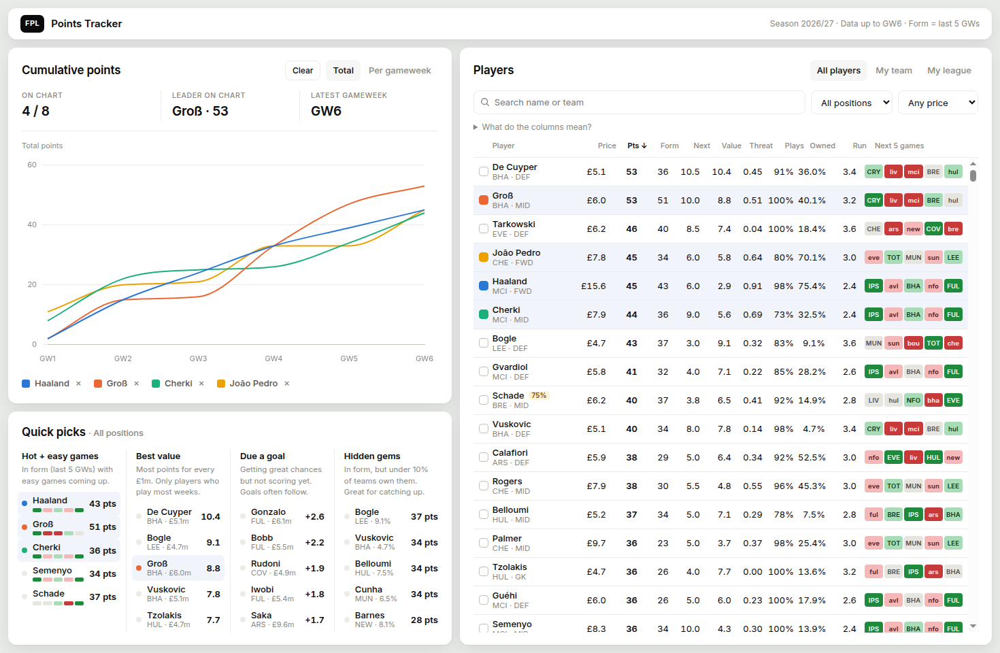
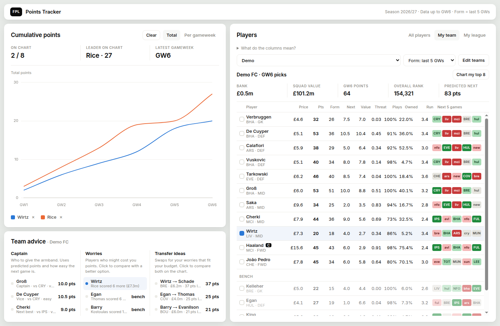

# FPL Points Tracker

A web page to help you pick transfers and beat your Fantasy Premier League mini league. It runs on your own computer, and everyone at home can use it.

- Compare players on a chart: season totals or points per gameweek.
- Sort every player by form, value, goal threat, minutes, ownership and upcoming fixtures.
- Get advice for your team: who to captain, who's a worry, and transfers you can afford.
- See how you stack up in your mini league: a league race chart, who your rivals own that you don't, and who they're captaining.





*Screenshots use a made-up example team.*

## Getting started

You need **[Git](https://git-scm.com/downloads)** and **[Docker](https://docs.docker.com/get-docker/)** (Docker Desktop on Windows or Mac).

**1. Download the app and its data**

```sh
git clone --recurse-submodules https://github.com/paulbrab/fpl-points-tracker.git
cd fpl-points-tracker
```

The player data lives in a separate project ([FPL-Elo-Insights](https://github.com/olbauday/FPL-Elo-Insights)). `--recurse-submodules` downloads it too, about 20MB. If you forgot that flag, run:

```sh
git submodule update --init --depth 1
```

**2. Start it**

```sh
cd app
docker compose up -d
```

**3. Open it**

Go to http://localhost:8080

**4. Add your team**

Click the **My team** tab, then **Edit teams**. Add a name and your FPL team ID. Add as many people as you like; everyone at home shares the same list.

To find your team ID, open your **Points** page on the FPL website. The number in the address is your ID:
`fantasy.premierleague.com/entry/`**`1234567`**`/event/6`

**To stop it:** `docker compose down` (in the `app` folder).

## Keeping the data up to date

The player data is updated **twice a day, at 07:30 and 17:30 UTC**. Get the latest with:

```sh
git submodule update --remote --depth 1
```

Run it after an update time, especially before you make transfers. `git status` will then show `FPL-Elo-Insights` as changed. That's normal.

Your team, your league and rivals' teams are fetched live from the FPL website, so they're always current. League data is saved for 10 minutes to go easy on the FPL website.

## Settings

Create a file called `app/.env` to change any of these, then run `docker compose up -d` again.

| Setting | Default | What it does |
|---|---|---|
| `BIND` | `127.0.0.1` | Who can open the app. The default is this computer only. Use `0.0.0.0` to let phones and other computers on your home Wi-Fi open it at `http://<this computer's IP>:8080`. |
| `PORT` | `8080` | The port the app uses. |
| `SEASON` | `2026-2027` | Which season folder in `FPL-Elo-Insights/data` to use. Change it when a new season starts. |
| `UID` / `GID` | `1000` | Linux only: your user and group ID (`id -u`, `id -g`), if they aren't 1000. Without this the app can't save your teams. |

Example `app/.env`:

```
BIND=0.0.0.0
PORT=8080
```

## Using it

**Chart (top left).** Click any player to add them (up to 8). Switch between *Total* (running total) and *Per gameweek* (bars). *Clear* removes everyone.

On the *My league* tab the chart becomes the **league race**: you plus the top of the table (up to 8 lines). *Vs average* shows how far above or below the league average each manager is after every gameweek. It's the easiest way to see who's pulling away.

**Players (right), four tabs:**

| Tab | What it shows |
|---|---|
| All players | Every player. Click a column name to sort. Filter by position and price. Hover a column name, or open "What do the columns mean?", for an explanation. |
| My team | Pick a team from the dropdown. Shows the squad, bench, money in the bank, overall rank and predicted points. "Form" can be set per team (default: last 5 gameweeks). |
| My league | Standings for one of your private leagues, with each team's chips still to play (WC, FH, BB, TC; crossed out = used). Click a rival to compare against just them. |
| Chips | Which chips you've used and which are left (you get two sets: one for GW1–19, one for GW20–38). A planner shows the best week for Bench Boost and Triple Captain, and flags blank and double gameweeks. |

**Panel under the chart** changes with the tab:

| Tab | Panel | What it does |
|---|---|---|
| All players | Quick picks | Hot + easy games, best value, due a goal, hidden gems |
| My team | Team advice | Captain pick, worries (injured, out of form, a cheaper player scoring more, hard games), transfer ideas you can afford. Click a worry or transfer idea to compare both players on the chart. |
| My league | League advice | Threats (players your rivals have and you don't), your differentials, who rivals are captaining |
| Chips | Chip advice | When to play each chip, with a "use it or lose it" warning near the deadline. The chart shows each chip's value week by week. |

**Fixture colours:** green = easy, red = hard. CAPITALS = home game, small letters = away.

**Projected points** (used by the chip planner) take each player's usual points rate (80% season average, 20% recent form) and scale it by each fixture: attackers by the goals their team is expected to score, defenders and keepers by their clean-sheet chances. Double gameweeks add both games. They assume you keep your current squad. See [How we know the projections work](#how-we-know-the-projections-work).

## How fixture difficulty works

Difficulty is about **the opponent** (like FPL's own ratings), worked out from expected goals (xG):

- Attackers are rated on how good the opponent's **defence** is. Defenders and keepers are rated on how good the opponent's **attack** is. Home games are a bit easier.
- Ratings are **opponent-adjusted**: xG against a weak defence counts for less than xG against a strong one.
- Every team starts from **last season's** ratings, pulled halfway back to average (squads change over the summer), and counted as if they'd already played 30 games. This season's matches gradually take over. Promoted teams start like last season's three weakest sides.
- Games are split into fifths: 1 = easiest, 5 = hardest.

### How we know it works

`tools/backtest_fixtures.py` replays past seasons week by week. Before each gameweek it rates teams using only earlier matches, predicts each team's xG, and measures the error against what really happened.

| Model | Error 2025/26 | Error 2026/27 so far |
|---|---|---|
| Know nothing (every team average) | 0.762 | 0.771 |
| First version (not adjusted, light use of last season) | 0.722 | 0.809 |
| **Current** | **0.711** | **0.767** |

The current model was better in 98–99% of bootstrap resamples, in both seasons. Single matches are very noisy, so even a good model only gets about 7% closer than "know nothing". Weighting recent games more was tested and made predictions slightly worse, so it isn't used.

Run it yourself (needs Python 3, nothing else): `python3 tools/backtest_fixtures.py FPL-Elo-Insights/data`

### How we know the projections work

`tools/backtest_projections.py` replays 2025/26 from GW6. Before each gameweek it uses only what was known then (points so far, injuries, fixture ratings from earlier matches) to project every regular player's points, and compares with what they really scored.

| Model | Next week: error | Next week: correlation | 4 weeks ahead: error | 4 weeks ahead: correlation |
|---|---|---|---|---|
| FPL's own prediction | 3.34 | 0.30 | – | – |
| Usual points rate, ignoring fixtures | 3.06 | 0.34 | 3.24 | 0.22 |
| Recent form only | 3.26 | 0.31 | 3.48 | 0.20 |
| **App (80% season, 20% form, with fixtures)** | **3.07** | **0.35** | **3.28** | **0.23** |

- **Better than FPL's own prediction** last season, on both measures.
- **Season average beats recent form.** We tested mixes from 50/50 to 100% season; 80/20 was best.
- **Does the planner's ★ week mean anything?** For the top 20 players each week, it picked their best of the next 10 normal (single-game) weeks. That week scored **1.26 points more** than an average week (90% range +0.96 to +1.55), and **2.06 more** than the week it rated hardest. That's what Triple Captain relies on.
- **Honest limits:** single weeks are very random (one goal is 4–6 points), so errors of about 3 points are normal for any model. The fixture effect slightly exaggerates how big the swings are: toning it down made errors a tiny bit smaller but made the ranking of weeks worse, so we kept it.

Run it yourself: `python3 tools/backtest_projections.py FPL-Elo-Insights/data`

## Privacy and safety

- Saved teams (names and FPL IDs) are kept in `app/storage/teams.json` on your computer. They're never committed to git or sent anywhere except the FPL website.
- There's **no login**. Anyone who can open the page can add or remove teams. That's fine at home, but **don't put it on the internet**.
- It uses PHP's built-in web server, which is made for small, local use like this.

## Files

| File | What it does |
|---|---|
| `app/docker-compose.yml` | Runs PHP's built-in web server |
| `app/public/index.html`, `style.css`, `app.js` | The page |
| `app/public/api/players.php` | Player stats from the CSVs |
| `app/public/api/fixtures.php` | Next 5 games for each team, with difficulty |
| `app/public/api/team.php` | A squad, bank and leagues from the FPL website |
| `app/public/api/league.php` | League standings and every rival's squad |
| `app/public/api/teams.php` | Saves the team list |
| `tools/backtest_fixtures.py` | Tests the fixture difficulty model against past seasons |
| `tools/backtest_projections.py` | Tests the points projections (used by the chip planner) against last season |
| `FPL-Elo-Insights/` | The player data ([separate project](https://github.com/olbauday/FPL-Elo-Insights), linked as a git submodule) |

## Credits

- **Player and match data:** [FPL-Elo-Insights](https://github.com/olbauday/FPL-Elo-Insights) by olbauday, the data engine behind [fplcore.com](https://fplcore.com). Thank you for keeping it open.
- **Charts:** [Chart.js](https://www.chartjs.org/).
- **Font:** [Inter](https://rsms.me/inter/).

## Disclaimer

This is a fan-made tool. It isn't connected to, or endorsed by, the Premier League or Fantasy Premier League.

Your team and league are read from the FPL website's public data, which isn't an official, documented service. It can change or stop working at any time. Please use the tool for personal use and don't hammer the FPL website with requests.

Advice and ratings are estimates from past data, not guarantees. Make your own calls!

## Licence

The code is released under the [MIT Licence](LICENSE). The data in `FPL-Elo-Insights` belongs to its owners and has its own terms (see their README).
